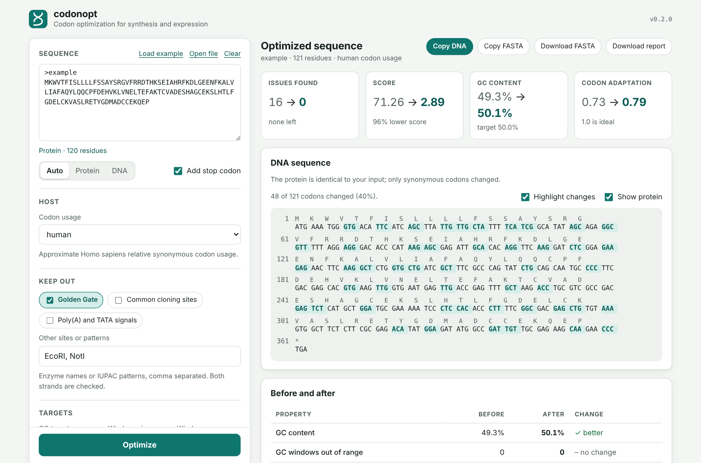

<h1 align="center">codonopt</h1>

<p align="center">
  <strong>Codon optimization for gene synthesis and expression.</strong><br>
  Rewrite the DNA of an open reading frame so it is easier to make and express,<br>
  without changing the protein it encodes.
</p>

<p align="center">
  <a href="https://github.com/thomdehoog/computational_codon_optimization/actions/workflows/ci.yml"></a>
  
  
  
  
  <a href="LICENSE"></a>
</p>

<p align="center">
  <picture>
    <source media="(prefers-color-scheme: dark)" srcset="docs/interface-dark.png">
    
  </picture>
</p>

Give it a protein, or an existing coding sequence, and it returns a synonymous
sequence that resolves mandatory requirements before balancing GC content,
repeats, hairpins, homopolymers, candidate splice signals and host codon usage.
Avoided motifs are mandatory by default; other criteria are soft preferences
unless explicitly required. It is a
pure-Python package with no runtime dependencies, a command line, a Python API
and a local web interface.

## Highlights

- **Requirements before preferences.** Mandatory violations take precedence over the weighted score. Every result is independently checked and marked valid or unresolved; an unresolved result is not proof that no solution exists.
- **Incremental scoring.** A codon swap re-scores nearby terms and updates repeat/hairpin indexes. Each edit still copies the DNA string; search cost is not strictly independent of gene length.
- **The protein cannot change.** The only move is swapping a codon for a synonymous one, so correctness holds by construction, not by checking afterwards.
- **Three ways in.** `codonopt` on the command line, a small Python API, and a browser or desktop interface.
- **Checked against brute force.** The tests compare the incremental score with a from-scratch recomputation and with simple reference implementations.

## Quickstart

```bash
pip install -e .

codonopt gui        # the web interface (opens in your browser)
```

Or from the command line:

```bash
codonopt optimize --add-stop --avoid golden_gate,EcoRI --seed 5 --splice-backend motif \
    --protein MKWVTFISLLLLFSSAYSRGVFRRDTHKSEIAHRFKDLGEENFKALVLIAFAQYLQQCPF
```

The sequence goes to stdout as FASTA (or `--out FILE`), the summary to stderr:

```
>protein codonopt table=human score=1.08 valid=true
ATGAAATGGGTGACATTCATCAGCTTACTGCTGCTGTTCTCTTCCGCTTACTCCCGGGGC
GTGTTTAGACGGGACACACACAAATCTGAGATCGCTCACAGGTTTAAGGACCTGGGCGAG
GAGAACTTCAAGGCCTTGGTTTTAATCGCCTTTGCACAGTATCTGCAGCAGTGCCCTTTC
TGA

Requirements        valid
Objective           53.57 -> 1.08  (improved by 52.49)

Property                      before       after
------------------------------------------------
GC fraction                    0.481       0.503
Codon adaptation index         0.774       0.842
Forbidden motif hits               1           0
Splice donor sites                 1           0
Splice acceptor sites              1           0
```

`--json FILE` writes the same numbers, the per-term score and the sequence.
Reports also include validity and the effective settings.

## Web interface

`codonopt gui` starts a local server and opens the interface in a native window
if [pywebview](https://pywebview.flowrl.com/) is installed (`pip install -e ".[gui]"`),
otherwise in your browser. Paste or open a protein or DNA sequence, pick a host
table and what to keep out, and press **Optimize**. You get:

- the sequence with every changed codon highlighted, and the protein above it;
- a before/after table, a GC plot along the sequence and the score breakdown;
- copy and download for the DNA, FASTA and a report; runs can be cancelled and keep the best result so far.

If mandatory requirements remain, the result is labelled **Unresolved candidate**.
Downloading it does not certify it as a valid design. Splice screening is off
by default; select it explicitly when relevant to the expression host.

It is local only: the server binds to loopback, checks Host and Origin, requires
a per-run token, sends a strict content security policy and never touches your
files. Add `--no-window --no-browser` to just serve it.

## What it optimizes

| Criterion | Why | Default |
| --- | --- | --- |
| Overall GC | Extreme GC complicates synthesis and PCR | target 0.50; length-scaled soft cost |
| Local GC | Stretches matter, not just the average | 30 bp windows within 0.30–0.70 |
| Direct repeats | Mis-assembly in synthesis, recombination in vivo | no repeated 12-mers |
| Hairpins | Stall synthesis and reverse transcription | no 10 bp inverted repeat, 3–60 nt loop |
| Homopolymers | Slippage in synthesis and sequencing | at most 6 identical bases |
| Forbidden motifs | Cloning sites, poly(A) signals, anything you name | none supplied; mandatory when supplied |
| Candidate splice signals | Screen for potential unwanted splicing | off; opt into MaxEntScan or a consensus screen |
| Codon usage | Rare codons slow translation | host codon adaptation index |

## Command line

```bash
codonopt optimize --protein-fasta gene.faa --out gene.fna   # design from a protein
codonopt optimize --dna-fasta old.fna --out new.fna         # improve a sequence
codonopt report --dna-fasta gene.fna                        # measure, change nothing
codonopt tables                                             # codon usage tables
codonopt motifs                                             # known motifs and groups
```

| Option | Effect |
| --- | --- |
| `--avoid SPEC` | Exclude motifs: a group (`golden_gate`, `common_cloning`, `regulatory`), an enzyme (`EcoRI`), an IUPAC pattern (`GGWCC`) or `NAME=PATTERN`. Both strands are checked. |
| `--table NAME` / `--table-file F` | Host codon usage: `human`, `ecoli`, `uniform`, or your own JSON/CSV. |
| `--weight NAME=VALUE` | Re-balance a term: `gc_global=200` holds the GC target harder, `usage=0` ignores codon preference. |
| `--splice-backend` | Default `none`. `auto` screens only the bundled human host, using MaxEntScan if installed, otherwise a consensus screen. `maxent` and `motif` are explicit overrides for other hosts; neither is automatically validated for them. |
| `--splice-strand` | Default `forward`, the expressed transcript. Select `reverse` or `both` only when appropriate. Restriction motifs still use both DNA strands. |
| `--require NAME` | Make `gc_window`, `repeat`, `hairpin`, `homopolymer` or `splice` mandatory. Repeat the option for several criteria. Required splice screening needs an explicit backend. |
| `--soft-motifs` | Make motif avoidance a preference instead of a requirement. |
| `--left-flank SEQ` / `--right-flank SEQ` | Score immutable construct context, including features across CDS junctions. Output FASTA remains the editable CDS. |
| `--protect-codon INDEX` | Preserve a zero-based codon of supplied starting DNA, including across restarts. Repeat for several positions. |
| `--exclude-codon CODON` | Forbid a codon explicitly; a zero frequency in a usage table is not an exclusion. |
| `--seed N` | Reproducible runs. |
| `--restarts N`, `--sweeps N`, `--anneal N` | More search effort. |
| `--seconds N` | Wall-clock cap (default 120). |
| `--repair-candidates N` / `--repair-max-codons N` | Bound coordinated repair per restart (defaults 2000 complete candidates and up to 3 codons; maximum 4). |

The CLI returns **0** when configured requirements are met, **2** when they
remain unresolved, and **1** for invalid input. It still emits the best
candidate and report on exit 2, including in quiet mode. A valid result can
have a higher soft score than its input because validity takes precedence.
Cancellation and time limits are recorded separately from validity.

`codonopt optimize --help` lists the rest. MaxEntScan is optional and not on
PyPI: `pip install "git+https://github.com/kepbod/maxentpy.git"`.

## Python API

```python
from codonopt import DesignConfig, OptimizerSettings, get_table, optimize, optimize_dna, resolve_motifs

config = DesignConfig(table=get_table("human"), motifs=tuple(resolve_motifs(["golden_gate"])))
result = optimize("MKWVTFISLLLLFSSAYS", config, OptimizerSettings(seed=1))
result.sequence, result.score, result.breakdown.terms
result.valid, result.unresolved_constraints, result.stop_reason
```

`measure(sequence, config)` returns what `report` prints; `optimize_dna()`
improves an existing sequence.

For an existing construct with fixed context and mandatory local GC:

```python
config = DesignConfig(
    motifs=tuple(resolve_motifs(["golden_gate"])),
    required=("motif", "gc_window"),
    gc_step=1,  # every base-offset window, when the synthesis policy needs it
    left_flank="ACGT", right_flank="TGCA",
    protected_codons=(0,),
)
result = optimize_dna("ATGGGTCTCAAA", config, OptimizerSettings(seed=5))
```

All context-dependent criteria scan the **complete supplied construct**,
including fixed-only regions. A violation confined to a fixed flank remains
unresolved. Codon usage and overall GC target apply to the CDS. Diagnostic
positions and GC profiles use construct coordinates; `cds_start` records the
offset. Flanks need not have lengths divisible by three.

JSON reports preserve original input/first seed, winning restart seed, full
effective configuration, actual codon-table data and hash, generated or supplied
seed, search settings, software/backend versions, validity and stop reason.
Custom scorer implementations and uninstalled backend sources additionally
need their source revision recorded externally. A seed and deterministic
proposal budgets replay a run; wall-clock truncation can differ by machine.

## How it works

Each penalty term is tied to a position (a GC window, a homopolymer, a motif
match, a splice window, a codon), so a codon swap only re-scores what sits near
it. Repeats and hairpins are not local, so an incrementally updated k-mer index
carries them. A candidate swap costs time proportional to the window sizes, not
the sequence length.

The search compares candidates by `(mandatory violation count, soft score)`.
It sweeps codons greedily, uses bounded coordinated repair around unresolved
regions, and optionally follows with simulated annealing and several restarts.
Annealing cannot worsen mandatory violation count. Intermediate edits in a
multi-codon repair are temporary; the complete candidate decides acceptance.
`SequenceState.audit()` recomputes a score from scratch; the tests check the
incremental path against it and against brute-force implementations in
`codonopt.metrics`.

Overall GC cost is `weight * abs(GC bases - target * CDS bases) / 300`.
This retains the old scale at 100 codons while making each GC-base change
carry the same tradeoff at different gene lengths. Local GC, repeats and the
other occurrence-based costs remain sums. The default target is a design
preference, not a universal expression optimum.

## Development

The Python package needs nothing but Python. The interface is written in
TypeScript in [`web/`](web/) and compiled with esbuild to plain HTML, CSS and
JavaScript in `src/codonopt/web/`. That output is committed, so running the
interface never needs Node; Node is only for working on it.

```bash
pip install -e ".[dev]" && pytest          # Python side

cd web && npm install
npm run build      # regenerate src/codonopt/web
npm run check      # type-check, and fail if the committed build is stale
npm test           # Playwright end-to-end tests against the real Python server
```

```
src/codonopt/   optimizer, scoring, CLI and the local server (stdlib only)
web/            TypeScript and CSS sources, build script, Playwright tests
benchmarks/     reproducible performance comparison
legacy/         the two original scripts this replaces, kept for reference
```

## History

This replaces two work-in-progress scripts, kept in [`legacy/`](legacy/). They
ran four independent passes that could undo each other, silently ignored the
local GC target (a fraction compared against a percentage range), and reloaded
the MaxEntScan matrices on every call. On an 800-residue protein the rewrite
takes 19 s instead of 234 s and ends with a better codon adaptation index
(0.90 vs 0.72) and no forbidden motifs (vs four). Details and a reproducible
benchmark are in [`legacy/README.md`](legacy/README.md).

## Limitations

- Hairpins are inverted repeats, not free-energy folds.
- The bundled `human` and `ecoli` tables are approximate; measure your own host
  for production work. The consensus splice screen is a filter, not a model.
- The search is local. A given `--seed` is reproducible, but another seed may do
  slightly better; use `--restarts` or `--anneal` when it counts.
- Bounded coordinated repair can still leave feasible requirements unresolved.
  The tool does not claim mathematical infeasibility from a search failure.
- A valid result meets the **configured checks**, not an unprovided synthesis
  vendor policy or a guarantee of improved expression. CAI and exact inverted
  repeats are proxies, not validated predictions of expression or RNA folding.
- The time limit covers search checks. Initial scoring and final independent
  validation/reporting must still complete and can add time beyond that budget.
- Version 0.3 changes motif validity, splice defaults/strand policy and GC cost
  scaling. Previous seeds can produce different designs. Before/after DNA
  reports now always use the original DNA, even when a later restart wins.

## License

[GPL-3.0](LICENSE) © Thom de Hoog
